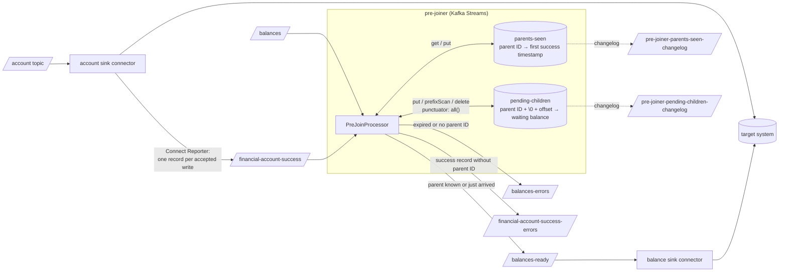
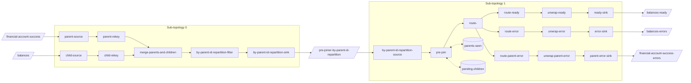

# Pre-joiner: hold back child records until the parent exists

Verified: 2026-10-06 on Docker (Colima), cp-kafka 8.3.2, Quarkus 3.40.1, Kafka Streams 4.2.1.

## What we show

A small Kafka Streams app to prevent the child sink connector from writing a child before its parent exists.

The example: two sink connectors write accounts and balances from two topics to one target system.
The target system rejects a balance when its account does not exist yet.
The balance connector then retries, until the account connector writes the parent.
The retries cost time, API calls and logins, and still give no guarantees that retries will succeed, risking data loss.

We are testing three things:

1. A balance whose parent is unknown does not reach `balances-ready`.
2. The success record of the parent releases all waiting balances, in arrival order.
3. A balance that waits longer than `app.max-wait` goes to `balances-errors`.

A record without a parent ID is not used, but recorded as error.
A balance without one goes to `balances-errors`.
A success record without one goes to `financial-account-success-errors`.

We run the app against a local broker.
We send two balances, then the parent of one of them.
We read the ready topic and the error topics.

There are no connectors in this repo. 

## How it works

The account connector writes one record to its Connect Reporter success topic for each record that the target system accepted.
This record is the signal that the parent exists.
`PreJoinTopology.java` re-keys the success topic and the balance topic by the parent ID, merges and repartitions them.
So a parent and all its balances always go to the same task.
The merge is to prevent two separately repartitioned inputs from getting the partition counts of their own source topics.
With 1 and 3 source partitions, there will be no co-partitioning and joins will be missed, silently.
`PreJoinProcessor.java` (Processor API) keeps two state stores: `parents-seen` and `pending-children`.

A balance for a known parent goes to `balances-ready` at once.
A balance for an unknown parent goes to `pending-children` with the key `parentId + \u0000 + offset`.
When the parent arrives, a prefix scan releases its balances in offset order.
A wall-clock punctuator moves balances older than `app.max-wait` to `balances-errors`, with the headers `pre-joiner.reason` and `pre-joiner.parent-id`.
A success record without a parent ID goes to `financial-account-success-errors`, with `pre-joiner.reason:no-parent-id`.
This topic shows a wrong `app.parent-id.in-parent` at once, before the balances expire.
The balance connector then reads `balances-ready` instead of `balances`.

The JSON pointers `app.parent-id.in-parent` and `app.parent-id.in-child` in `src/main/resources/application.yml` select the parent ID.
Remove a pointer to use the record key.

### Dataflow

The pre-joiner sits between the balance topic and the balance connector.
The account connector feeds it through the Connect Reporter.
Each state store has a changelog topic, so a restarted or moved task restores its state.



### Topology

The topology has two sub-topologies.
Sub-topology 0 re-keys and merges both inputs, then writes them to the repartition topic.
Sub-topology 1 reads the repartition topic and runs `pre-join` with both stores, then splits the output to three sinks.
The node names are the `Named.as(...)` names in `PreJoinTopology.java`.
Section "Look" shows the same topology as text, from `topology.describe()`.



## Requirements

- Docker with Compose. The image build needs no local JDK.
- About 2 GB of free memory for Kafka and the app.
- Port 18080 free on the host, for the health endpoint.
- The first image build downloads Gradle and the Quarkus dependencies.

## Run

1. Start Kafka.

```bash
docker compose up -d --wait kafka
```

2. Create the five topics with three partitions each.

```bash
for t in financial-account-success balances balances-ready balances-errors financial-account-success-errors; do
  docker compose exec kafka kafka-topics --bootstrap-server kafka:29092 --create --topic $t --partitions 3
done
```

3. Build and start the pre-joiner. Wait until the health check is `UP`.

```bash
docker compose up -d --build pre-joiner
until curl -s localhost:18080/q/health/ready | jq -e '.status=="UP"' >/dev/null 2>&1; do sleep 3; done
```

4. Send two balances. Their parents FA-1 and FA-2 do not exist yet.

```bash
printf '%s\n' \
  'BAL-1|{"balanceId":"BAL-1","financialAccountId":"FA-1","amount":100}' \
  'BAL-2|{"balanceId":"BAL-2","financialAccountId":"FA-2","amount":200}' |
docker compose exec -T kafka kafka-console-producer --bootstrap-server kafka:29092 --topic balances \
  --reader-property parse.key=true --reader-property key.separator='|'
```

5. Count the records in `balances-ready`. Zero records means that both balances wait.

<!-- doc-check: skip -->
```bash
docker compose exec kafka kafka-console-consumer --bootstrap-server kafka:29092 --topic balances-ready \
  --from-beginning --timeout-ms 5000 2>/dev/null | wc -l | tr -d ' '
```

```
0
```

6. Send the success record of the parent FA-1.

```bash
echo 'FA-1|{"externalId":"FA-1","name":"Account FA-1"}' |
docker compose exec -T kafka kafka-console-producer --bootstrap-server kafka:29092 --topic financial-account-success \
  --reader-property parse.key=true --reader-property key.separator='|'
```

7. Send a third balance for FA-1. The parent is known now, so it does not wait.

```bash
echo 'BAL-3|{"balanceId":"BAL-3","financialAccountId":"FA-1","amount":300}' |
docker compose exec -T kafka kafka-console-producer --bootstrap-server kafka:29092 --topic balances \
  --reader-property parse.key=true --reader-property key.separator='|'
```

8. Send a success record without `externalId`. This is what a wrong JSON pointer looks like.

```bash
echo 'FA-9|{"id":"FA-9","name":"Account FA-9"}' |
docker compose exec -T kafka kafka-console-producer --bootstrap-server kafka:29092 --topic financial-account-success \
  --reader-property parse.key=true --reader-property key.separator='|'
```

9. Wait until BAL-2 expires. `docker-compose.yml` sets `APP_MAX_WAIT: 60s`, so this takes about 70 seconds.

```bash
until docker compose logs pre-joiner 2>&1 | grep -q "waited longer"; do sleep 5; done
```

## Look

The ready topic has the balances of FA-1 only, in arrival order:

```bash
docker compose exec kafka kafka-console-consumer --bootstrap-server kafka:29092 --topic balances-ready \
  --from-beginning --timeout-ms 5000 --formatter-property print.key=true 2>/dev/null
```

```
BAL-1	{"balanceId":"BAL-1","financialAccountId":"FA-1","amount":100}
BAL-3	{"balanceId":"BAL-3","financialAccountId":"FA-1","amount":300}
```

The error topic has BAL-2, with the reason and the parent ID in the headers:

```bash
docker compose exec kafka kafka-console-consumer --bootstrap-server kafka:29092 --topic balances-errors \
  --from-beginning --timeout-ms 5000 --formatter-property print.key=true --formatter-property print.headers=true 2>/dev/null
```

```
pre-joiner.reason:expired,pre-joiner.parent-id:FA-2	BAL-2	{"balanceId":"BAL-2","financialAccountId":"FA-2","amount":200}
```

The parent error topic has FA-9, because it has no `externalId`:

```bash
docker compose exec kafka kafka-console-consumer --bootstrap-server kafka:29092 --topic financial-account-success-errors \
  --from-beginning --timeout-ms 5000 --formatter-property print.key=true --formatter-property print.headers=true 2>/dev/null
```

```
pre-joiner.reason:no-parent-id	FA-9	{"id":"FA-9","name":"Account FA-9"}
```

The app log shows the wait, the release, the parent without an ID and the expiry:

```bash
docker compose logs pre-joiner 2>&1 | grep -o -E "Child .*|Parent .*|[0-9]+ children waited.*"
```

```
Child BAL-1 waits for parent FA-1
Child BAL-2 waits for parent FA-2
Parent FA-1 arrived: released 1 waiting children
Parent record with key FA-9 has no parent ID
1 children waited longer than PT1M and went to the error topic
```

The topology as text, from `topology.describe()`. The app logs it at `DEBUG` at start:

```bash
docker compose logs --no-log-prefix pre-joiner 2>&1 |
  awk '/^Topologies:/{p=1} !p{next} /^$/{b++; if(b==2) exit; next} {if(b) print ""; b=0; print}'
```

```
Topologies:
   Sub-topology: 0
    Source: child-source (topics: [balances])
      --> child-rekey
    Source: parent-source (topics: [financial-account-success])
      --> parent-rekey
    Processor: child-rekey (stores: [])
      --> merge-parents-and-children
      <-- child-source
    Processor: parent-rekey (stores: [])
      --> merge-parents-and-children
      <-- parent-source
    Processor: merge-parents-and-children (stores: [])
      --> by-parent-id-repartition-filter
      <-- parent-rekey, child-rekey
    Processor: by-parent-id-repartition-filter (stores: [])
      --> by-parent-id-repartition-sink
      <-- merge-parents-and-children
    Sink: by-parent-id-repartition-sink (topic: by-parent-id-repartition)
      <-- by-parent-id-repartition-filter

  Sub-topology: 1
    Source: by-parent-id-repartition-source (topics: [by-parent-id-repartition])
      --> pre-join
    Processor: pre-join (stores: [pending-children, parents-seen])
      --> route-
      <-- by-parent-id-repartition-source
    Processor: route- (stores: [])
      --> route-ready, route-error, route-parent-error
      <-- pre-join
    Processor: route-error (stores: [])
      --> unwrap-error
      <-- route-
    Processor: route-parent-error (stores: [])
      --> unwrap-parent-error
      <-- route-
    Processor: route-ready (stores: [])
      --> unwrap-ready
      <-- route-
    Processor: unwrap-error (stores: [])
      --> error-sink
      <-- route-error
    Processor: unwrap-parent-error (stores: [])
      --> parent-error-sink
      <-- route-parent-error
    Processor: unwrap-ready (stores: [])
      --> ready-sink
      <-- route-ready
    Sink: error-sink (topic: balances-errors)
      <-- unwrap-error
    Sink: parent-error-sink (topic: financial-account-success-errors)
      <-- unwrap-parent-error
    Sink: ready-sink (topic: balances-ready)
      <-- unwrap-ready
```

Kafka Streams created one repartition topic and two changelog topics:

```bash
docker compose exec kafka kafka-topics --bootstrap-server kafka:29092 --list | grep '^pre-joiner'
```

```
pre-joiner-by-parent-id-repartition
pre-joiner-parents-seen-changelog
pre-joiner-pending-children-changelog
```

## Expected

```
BAL-1	{"balanceId":"BAL-1","financialAccountId":"FA-1","amount":100}
BAL-3	{"balanceId":"BAL-3","financialAccountId":"FA-1","amount":300}
pre-joiner.reason:expired,pre-joiner.parent-id:FA-2	BAL-2	{"balanceId":"BAL-2","financialAccountId":"FA-2","amount":200}
pre-joiner.reason:no-parent-id	FA-9	{"id":"FA-9","name":"Account FA-9"}
```

BAL-1 waited and was released by FA-1. BAL-3 went through at once. BAL-2 never got a parent and expired.
FA-9 has no `externalId` and went to the parent error topic.

The unit tests prove the same claims, plus the prefix edge case `FA-1` against `FA-10`.
Run them without a local JDK:

```bash
docker run --rm -v "$PWD":/work -v pre-joiner-gradle:/root/.gradle -w /work eclipse-temurin:21-jdk ./gradlew --no-daemon -q test
```

## Notes

- The success topic has only parents that the connector wrote after the reporter was turned on. Seed `financial-account-success` with the existing account IDs before the balance connector changes to `balances-ready`. Without the seed, every balance of an old account expires.
- The format of the Connect Reporter success record is not verified. Read a real record first, then set `app.parent-id.in-parent`. Records in `financial-account-success-errors` mean that the pointer is wrong. The default name of the success topic is `${connector}-success`; `reporter.result.topic.name` changes it.
- The app reads and writes values as JSON strings. Production topics often use Avro with Schema Registry. Then change the serdes and read the parent ID from the Avro record. The app does not copy the original headers to `balances-ready`.
- `parents-seen` keeps every parent ID forever, because balance updates for old accounts keep coming. The store is one small entry per account. `pending-children` holds only waiting balances.
- A balance that expired is gone. A later parent does not release it. Replay it from `balances-errors` after the fix.

## Clean up

```bash
docker compose down -v
docker volume rm pre-joiner-gradle
```

## Versions

I checked these on 2026-10-06 as the newest stable releases:

- `confluentinc/cp-kafka:8.3.2`: Docker Hub tag list.
- Quarkus 3.40.1 (`io.quarkus.platform:quarkus-bom`): Maven Central metadata. 4.0.0.Beta1 exists, but it is a beta.
- Kafka Streams 4.2.1: managed by the Quarkus 3.40.1 BOM (`gradlew dependencies`). Maven Central has 4.3.1.
- Gradle 9.8.0: `services.gradle.org/versions/current`.
- Build image `eclipse-temurin:21-jdk`, run image `registry.access.redhat.com/ubi9/openjdk-21:1.23`: Red Hat registry tag list.
